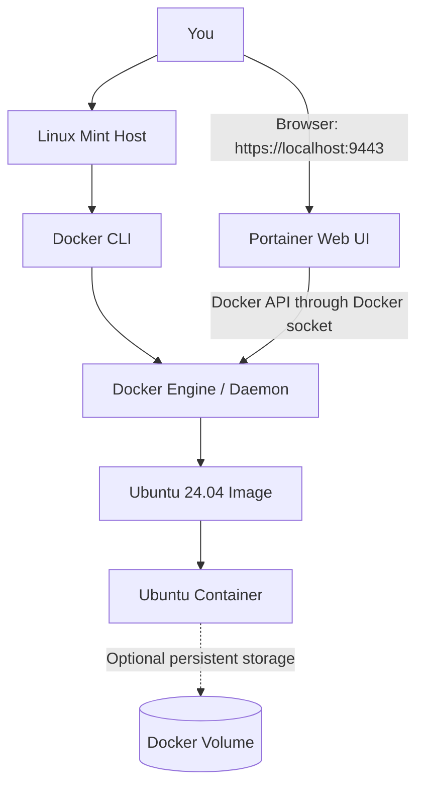
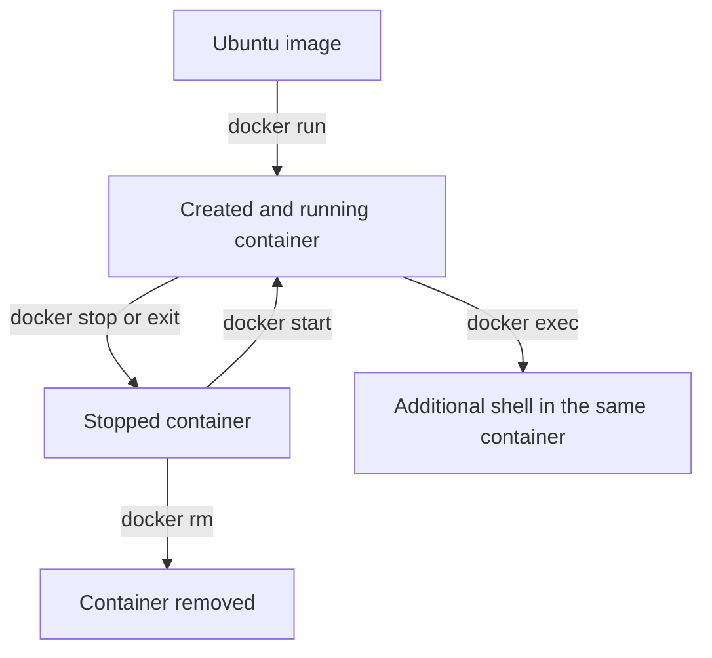

# Docker Setup on Linux Mint

A beginner-friendly guide to installing Docker Engine on Linux Mint, running an Ubuntu container, managing containers from the terminal, and using Portainer as a graphical dashboard.

## Practice environment

| Item | Value |
|---|---|
| Host operating system | Linux Mint (Ubuntu-based) |
| Docker image | `ubuntu:24.04` |
| Container name | `ubuntu-container` |
| Graphical interface | Portainer Community Edition |
| Portainer address | `https://localhost:9443` |

---

## 1. What is Docker?

Docker is a platform for building and running applications in isolated environments called **containers**.

| Term | Explanation |
|---|---|
| Host | Your Linux Mint computer |
| Docker Engine | The service that builds and manages containers |
| Image | A read-only template used to create a container |
| Container | A running or stopped instance created from an image |
| Volume | Storage that can preserve data independently of a container's writable layer |

## 2. Docker architecture

This diagram shows how the Linux Mint host, Docker CLI, Docker Engine, image, container, and Portainer work together.



> **Important:** Run Docker commands in the **Linux Mint host terminal**. The Ubuntu container is a separate environment. Docker commands will not be available inside it unless Docker CLI and daemon access are deliberately configured there.

---

## 3. Install Docker Engine

Docker's Ubuntu installation instructions can be used as a starting point on Ubuntu-based Linux Mint. However, Docker does not officially support or test every Ubuntu derivative. Use the Ubuntu base codename—not the Linux Mint release codename—when configuring the repository.

### 3.1 Check the Linux Mint base

Run on the Linux Mint host:

```bash
cat /etc/os-release
```

Find `UBUNTU_CODENAME`. The repository command below uses that value when it is available.

### 3.2 Install prerequisites

```bash
sudo apt update
sudo apt install -y ca-certificates curl
```

### 3.3 Add Docker's official GPG key and APT repository

```bash
sudo install -m 0755 -d /etc/apt/keyrings

sudo curl -fsSL https://download.docker.com/linux/ubuntu/gpg \
  -o /etc/apt/keyrings/docker.asc

sudo chmod a+r /etc/apt/keyrings/docker.asc

sudo tee /etc/apt/sources.list.d/docker.sources > /dev/null <<EOF
Types: deb
URIs: https://download.docker.com/linux/ubuntu
Suites: $(. /etc/os-release && echo "${UBUNTU_CODENAME:-$VERSION_CODENAME}")
Components: stable
Architectures: $(dpkg --print-architecture)
Signed-By: /etc/apt/keyrings/docker.asc
EOF

sudo apt update
```

### 3.4 Install Docker Engine and plugins

```bash
sudo apt install -y docker-ce docker-ce-cli containerd.io docker-buildx-plugin docker-compose-plugin
```

### 3.5 Start Docker and verify the installation

```bash
sudo systemctl enable --now docker
sudo systemctl status docker
sudo docker run hello-world
```

If the status command opens a screen, press `q` to return to the terminal.

Check the installed versions:

```bash
docker --version
docker compose version
```

---

## 4. Download and run an Ubuntu container

### 4.1 Download the Ubuntu image

Run on the Linux Mint host:

```bash
sudo docker pull ubuntu:24.04
```

### 4.2 Create and enter the container

```bash
sudo docker run -it --name ubuntu-container ubuntu:24.04
```

Your terminal prompt should change to something similar to:

```text
root@<container-id>:/#
```

This prompt means you are **inside the Ubuntu container**, not on the Linux Mint host.

### 4.3 Update Ubuntu and install practice tools

Run these commands **inside the container**:

```bash
apt update
apt upgrade -y
apt install -y git curl wget nano vim tree iputils-ping
```

If a timezone selection screen appears, choose:

- Geographic area: `Asia`
- City/region: `Kolkata`

### 4.4 Create a practice directory and file

Still inside the container:

```bash
mkdir -p /Docker-Practice/Docker-Practice
cd /Docker-Practice/Docker-Practice

echo "Hello from Docker Container!" > hello.txt

cat hello.txt
tree /Docker-Practice
```

Expected file content:

```text
Hello from Docker Container!
```

Expected directory structure:

```text
/Docker-Practice/
└── Docker-Practice/
    └── hello.txt
```

---

## 5. Host terminal vs. container terminal

| Example prompt | Where you are |
|---|---|
| `shamshad@shamshad-HP-348-G5:~$` | Linux Mint host |
| `root@<container-id>:/#` | Ubuntu container |

The Docker CLI is installed on the host in this setup. If you type `docker` inside the Ubuntu container and see `docker: command not found`, that is expected.

### Exit the container

Run inside the container:

```bash
exit
```

You will return to the Linux Mint host terminal.

---

## 6. Manage the container from Linux Mint

Run the following commands on the **Linux Mint host**, not inside the container.

### 6.1 List all containers

```bash
sudo docker ps -a
```

### 6.2 Start the existing container

```bash
sudo docker start ubuntu-container
```

### 6.3 List running containers

```bash
sudo docker ps
```

### 6.4 Open a shell inside the running container

```bash
sudo docker exec -it ubuntu-container bash
```

Check the practice file:

```bash
cat /Docker-Practice/Docker-Practice/hello.txt
```

Exit the container shell when finished:

```bash
exit
```

### 6.5 Stop the container

Run on the host:

```bash
sudo docker stop ubuntu-container
```

### Container lifecycle



> **Data note:** Stopping and starting a container normally preserves files in its writable layer. Removing the container removes that writable layer. Use a Docker volume or bind mount for data that must survive container removal.

---

## 7. Portainer: Docker graphical interface

Portainer provides a browser-based dashboard for managing Docker resources such as containers, images, volumes, and networks.

### 7.1 Open Portainer

If Portainer is already installed and running, open:

**https://localhost:9443**

On the first visit, your browser may show a certificate warning because Portainer commonly uses a self-signed HTTPS certificate. Proceed only if you are connecting to your own local Portainer instance.

### 7.2 Install Portainer Community Edition

If Portainer is not installed, run these commands on the **Linux Mint host**:

```bash
sudo docker volume create portainer_data

sudo docker run -d \
  --name portainer \
  --restart=always \
  -p 9443:9443 \
  -v /var/run/docker.sock:/var/run/docker.sock \
  -v portainer_data:/data \
  portainer/portainer-ce:lts
```

Then visit **https://localhost:9443**, create the initial administrator account, and select the local Docker environment if prompted.

### 7.3 What can you manage in Portainer?

- **Containers:** Start, stop, restart, inspect, and view logs.
- **Images:** Pull and inspect images.
- **Volumes:** Create and manage persistent storage.
- **Networks:** Inspect and manage Docker networks.
- **Console:** Open a terminal inside a container.

> **Security warning:** Access to `/var/run/docker.sock` gives Portainer powerful control over the Docker host. Keep this setup local, protect the administrator account, and do not expose the dashboard publicly without appropriate security controls.

---

## 8. Useful Docker commands

Run these commands on the Linux Mint host unless stated otherwise.

| Command | Purpose |
|---|---|
| `sudo docker images` | List downloaded images |
| `sudo docker ps` | List running containers |
| `sudo docker ps -a` | List all containers |
| `sudo docker pull ubuntu:24.04` | Download the Ubuntu image |
| `sudo docker start ubuntu-container` | Start the existing container |
| `sudo docker stop ubuntu-container` | Stop the container |
| `sudo docker restart ubuntu-container` | Restart the container |
| `sudo docker exec -it ubuntu-container bash` | Open a shell in the running container |
| `sudo docker logs ubuntu-container` | View container logs |
| `sudo docker inspect ubuntu-container` | Inspect container configuration |
| `sudo docker volume ls` | List Docker volumes |
| `sudo docker network ls` | List Docker networks |

> **Careful:** `docker rm` removes a container. Do not remove a container if you still need files stored only in its writable layer.

---

## 9. Troubleshooting

### Problem 1: Permission denied for `/var/run/docker.sock`

Use `sudo`:

```bash
sudo docker ps
```

Optional: allow your Linux user to run Docker without `sudo`:

```bash
sudo usermod -aG docker "$USER"
```

Log out and log back in for the group change to take effect. Then verify:

```bash
docker ps
```

> **Security warning:** Membership in the `docker` group grants root-level privileges. Add only trusted users.

### Problem 2: `docker: command not found` inside the container

This guide runs Docker from the Linux Mint host. Return to the host terminal:

```bash
exit
```

Then run Docker commands in the Linux Mint terminal.

### Problem 3: The container is stopped

Check all containers and start the existing one:

```bash
sudo docker ps -a
sudo docker start ubuntu-container
```

### Problem 4: Portainer page does not open

Check whether Portainer is running:

```bash
sudo docker ps
```

Check its logs:

```bash
sudo docker logs portainer
```

Confirm that port `9443` is published, then try:

**https://localhost:9443**

---

## 10. What I practised

- Installed and verified Docker Engine on Linux Mint.
- Pulled the `ubuntu:24.04` image.
- Created and entered an Ubuntu container.
- Updated Ubuntu and installed Git, Curl, Wget, Nano, Vim, Tree, and Ping.
- Created a directory and `hello.txt` inside the container.
- Practised `docker ps`, `docker ps -a`, `docker start`, `docker exec`, and `docker stop`.
- Learned the difference between the Linux Mint host terminal and the container terminal.
- Set up Portainer as a graphical Docker management interface.

---

## Official references

- [Docker Engine installation on Ubuntu](https://docs.docker.com/engine/install/ubuntu/)
- [Docker post-installation steps for Linux](https://docs.docker.com/engine/install/linux-postinstall/)
- [Portainer documentation](https://docs.portainer.io/)

---

**Learning note:** This README documents a learning/practice setup. Linux Mint is an Ubuntu derivative, and Docker's Ubuntu installation instructions may need adjustment depending on the Mint release and its Ubuntu base. Check the official documentation before applying these steps to another machine.
