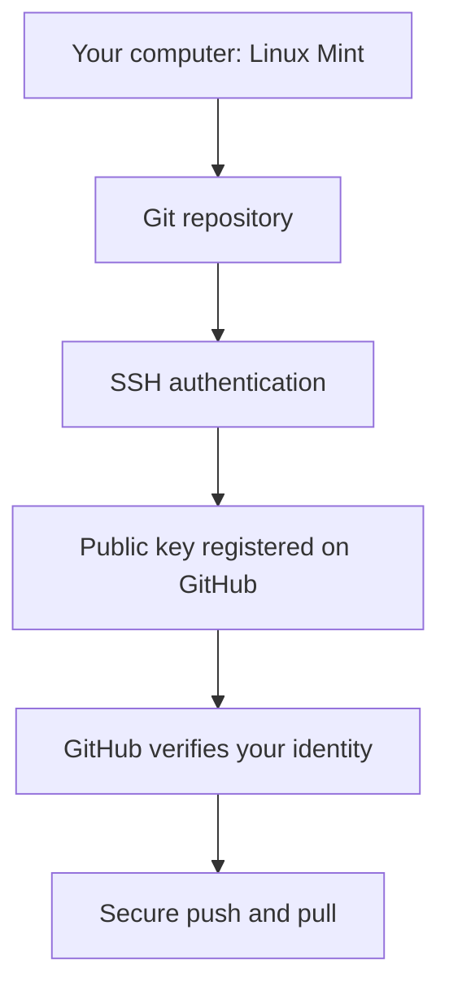
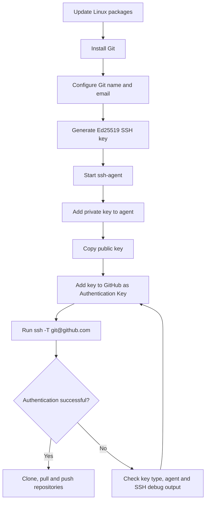

# Git & GitHub SSH Setup on Linux Mint

A step-by-step record of setting up Git and SSH authentication with GitHub on Linux Mint.

 
## 1. Project Overview


This documentation covers:

- Installing Git on Linux Mint
- Checking the Git version
- Setting Git username and email
- Generating an SSH key using Ed25519
- Starting the SSH agent and adding the private key
- Adding the public key to GitHub as an **Authentication Key**
- Testing the SSH connection
- Fixing the `Permission denied (publickey)` issue
- Basic Git commands for uploading a project to GitHub

## 2. Environment Used

| Item | Details |
|---|---|
| Operating system | Linux Mint |
| Computer | HP 348 G5 |
| Git version | 2.43.0 |
| SSH key type | Ed25519 |
| GitHub account | `shamshad2315` |
| Default branch | `main` |

## 3. How Git, GitHub and SSH Work

- **Git** tracks changes in files on your computer.
- **GitHub** hosts Git repositories online.
- **SSH** provides a secure way for your computer to authenticate with GitHub.
- The **public key** is added to GitHub; the **private key** stays on your computer.



## 4. Install Git

Update package information:

```bash
sudo apt update
```

Install Git:

```bash
sudo apt install git -y
```

Check the installed version:

```bash
git --version
```

Expected output from this setup:

```text
git version 2.43.0
```

## 5. Configure Git Identity

Set your Git display name:

```bash
git config --global user.name "Shamshad Ansari"
```

Set your Git email:

```bash
git config --global user.email "YOUR_GITHUB_EMAIL"
```

Set the default branch name:

```bash
git config --global init.defaultBranch main
```

Check the configuration:

```bash
git config --global --list
```

> **Important:** During the setup, the email entered was `shamshadansari43984@gnail.com`. Check this carefully. If `gnail.com` was a typing mistake and your actual email is on `gmail.com`, update it using the command below:

```bash
git config --global user.email "shamshadansari43984@gnail.com"
```

The email configured in Git should normally be an email associated with your GitHub account if you want commits linked to that account.

## 6. Generate an SSH Key

Generate an Ed25519 key pair:

```bash
ssh-keygen -t ed25519 -C "shamshadansari43984@gnail.com"
```

When asked where to save the key, press **Enter** to accept the default location:

```text
/home/YOUR_LINUX_USERNAME/.ssh/id_ed25519
```

You may set a passphrase for additional protection, or press Enter to leave it empty.

This creates two files:

| File | Purpose |
|---|---|
| `~/.ssh/id_ed25519` | Private key — keep secret |
| `~/.ssh/id_ed25519.pub` | Public key — add this to GitHub |

Show the public key:

```bash
cat ~/.ssh/id_ed25519.pub
```

Copy the complete output. Never share or upload `id_ed25519` (the private key).

## 7. Start SSH Agent and Add the Key

Start the SSH agent:

```bash
eval "$(ssh-agent -s)"
```

Add your private key to the agent:

```bash
ssh-add ~/.ssh/id_ed25519
```

Check that the key is loaded:

```bash
ssh-add -l
```

During this setup, the agent showed a loaded Ed25519 key with fingerprint:

```text
SHA256:lDlZzgV19m0yHKD9kNPP5+qyzpEVNhSPgbqZRNBMO0A
```

Your fingerprint may be different if you generate a new key.

## 8. Add the Public Key to GitHub

1. Sign in to GitHub.
2. Open **Settings**.
3. Go to **SSH and GPG keys**.
4. Select **New SSH key**.
5. Give the key a recognizable title, such as `Linux Mint HP Laptop`.
6. For **Key type**, select **Authentication Key**.
7. Paste the complete output of `cat ~/.ssh/id_ed25519.pub`.
8. Click **Add SSH key**.

> **Important lesson from this setup:** The key was initially added as a **Signing key**. That did not authenticate Git operations. It was removed and added again as an **Authentication Key**, after which SSH authentication worked.

## 9. Test the SSH Connection

Run:

```bash
ssh -T git@github.com
```

On the first connection, SSH may ask whether you trust GitHub's host key. Verify the fingerprint against GitHub's published SSH key fingerprints before accepting. If verified, type:

```text
yes
```

Successful authentication displays a message similar to:

```text
Hi shamshad2315! You've successfully authenticated, but GitHub does not provide shell access.
```

This is **success**, not an error. GitHub does not provide an interactive shell through SSH; the message confirms that authentication worked.

## 10. Problem Faced and Solution

### Problem: `Permission denied (publickey)`

Example:

```text
git@github.com: Permission denied (publickey).
```

**Possible causes and checks:**

1. The public key was not added to the correct GitHub account.
2. The key was added as a **Signing Key** instead of an **Authentication Key**.
3. The SSH agent was not running or the private key was not loaded.
4. A different SSH key was being offered.

**Commands to check:**

```bash
eval "$(ssh-agent -s)"
ssh-add ~/.ssh/id_ed25519
ssh-add -l
ssh -T git@github.com
```

If it still fails, inspect SSH authentication details:

```bash
ssh -vT git@github.com
```

Look for lines showing which key SSH offers. Never share private-key contents or sensitive debug information publicly.

**What fixed the issue in this setup:** The key had been added to GitHub as a Signing Key. It was changed to an **Authentication Key**, and the SSH test then succeeded.

## 11. Useful Git Commands

Check repository status:

```bash
git status
```

Initialize a repository:

```bash
git init
```

Set the branch to `main`:

```bash
git branch -M main
```

Stage all files:

```bash
git add .
```

Create a commit:

```bash
git commit -m "Initial commit"
```

Add a GitHub SSH remote:

```bash
git remote add origin git@github.com:YOUR_GITHUB_USERNAME/YOUR_REPOSITORY.git
```

Push the `main` branch:

```bash
git push -u origin main
```

For later updates:

```bash
git add .
git commit -m "Describe your changes"
git push
```

Clone an existing repository using SSH:

```bash
git clone git@github.com:YOUR_GITHUB_USERNAME/YOUR_REPOSITORY.git
```

## 12. Complete Setup Flow



## 13. Security Checklist

- [ ] Add only the `.pub` public key to GitHub.
- [ ] Never share `~/.ssh/id_ed25519`.
- [ ] Do not upload private keys to GitHub repositories.
- [ ] Use a passphrase where practical.
- [ ] Keep your GitHub account protected with two-factor authentication.
- [ ] Verify host fingerprints when SSH asks to trust a new host.
- [ ] Remove old or compromised SSH keys from GitHub.

## 14. Final Result

Git was installed and configured on Linux Mint. An Ed25519 SSH key was generated, loaded into the SSH agent, and registered on GitHub as an **Authentication Key**. The final SSH test succeeded:

```text
Hi shamshad2315! You've successfully authenticated, but GitHub does not provide shell access.
```

**Status: GitHub SSH authentication successfully configured.**

---

### Author

**Shamshad Ansari**  
GitHub: [@shamshad2315](https://github.com/shamshad2315)

*This README documents the setup process and troubleshooting steps from the Linux Mint GitHub SSH configuration.*
